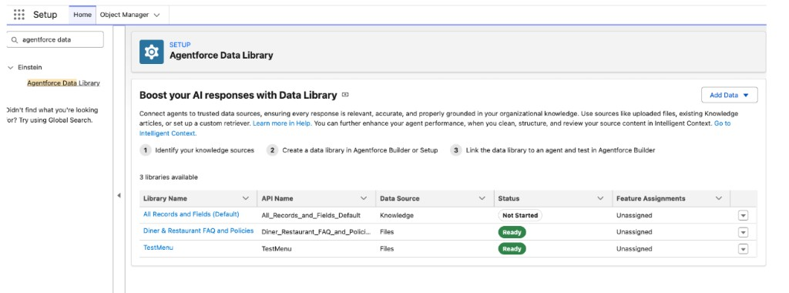
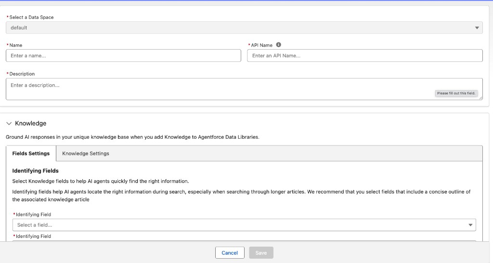
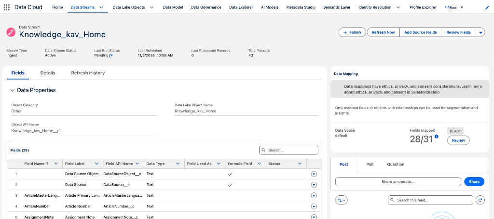
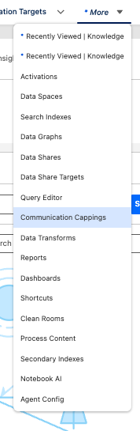
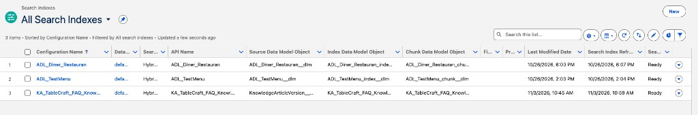
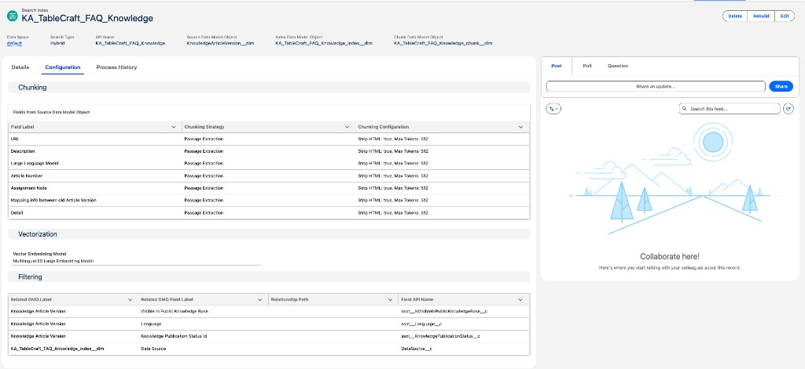
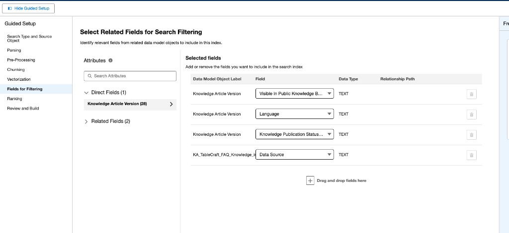

# RAG Knowledge Article (`Knowledge__kav`) Setup & Implementation Plan

This step-by-step build sequence sets up the **Salesforce Knowledge (`Knowledge__kav`)** RAG pipeline (`Restaurant_ID__c` + `Category__c`) and wires it into `TableCraft_Agent` (`subagent faq`) via `CLL_DiningKnowledgeRetriever.cls`.

---

## Step 1: Enable "Knowledge User" & Lightning Knowledge in Salesforce Setup (UI — 2 mins)

Before Salesforce lets you see `Knowledge__kav` or create articles, enable Knowledge on your user record:

1. Go to **Setup → Users → Users**, click **Edit** next to your user record, check the `**Knowledge User`** checkbox, and click **Save**.
2. In Quick Find, search **Knowledge Settings** → if **Lightning Knowledge** isn't enabled yet, check **Enable Lightning Knowledge** and click **Save**.

---

## Step 2: Create the 2 Custom Metadata Fields on `Knowledge__kav` (Metadata Deploy or Object Manager)

Because `Knowledge__kav` already comes with `Summary` (`TextArea`) and `**Detail__c**` (`Rich Text Area`, `131072` length, already on the page layout) for the article body that Data 360 chunks and embeds, we only need to add the 2 structured metadata fields in **Setup → Object Manager → Knowledge (`Knowledge__kav`) → Fields & Relationships**:

1. `**Restaurant_ID__c**` (`Text(50)`) — holds `REST-ATX-01`, `REST-NYC-01`, etc.
2. `**Category__c**` (`Picklist`: `Menu`, `Parking_And_Access`, `Policies`) — separates topics per restaurant so updating a restaurant's menu only re-indexes the `Menu` article row.
3. **Field-Level Security (FLS):** Grant **Read** access on `Restaurant_ID__c`, `Category__c`, and `Detail__c` to:
  - **Data Cloud Salesforce Connector** permission set (so Data 360 ingests `Restaurant_ID__c`, `Category__c`, and `Detail__c`).
  - **System Administrator** and **Agentforce Service Agent** user profile/permission set.

---

## Step 3: Seed & Publish the `Knowledge__kav` Articles for Our Restaurants (Automated via Apex Script)

- **Saved Script (Executed Nov 3, 2026 at 9:09 AM PST):** `[../scripts/seed_post_oak_menu_knowledge.apex](../scripts/seed_post_oak_menu_knowledge.apex)`
- **Live Record Created in `agentforce-org`:** `Knowledge__kav` ID `ka0g7000001cvSvAAI` (`ArticleNumber = 000001042`, `Restaurant_ID__c = 'REST-ATX-02'`, `Category__c = 'Menu'`, `PublishStatus = 'Online'`)

Instead of manually typing articles in the Salesforce UI, run an **Anonymous Apex script** (`sf apex run --file docs/FAQ_TableCraft_Agent/scripts/seed_post_oak_menu_knowledge.apex --target-org agentforce-org`) that creates and publishes the `Knowledge__kav` articles (`Menu`, `Parking_And_Access`, `Policies`):

```apex
// Example of seeding AND publishing a Knowledge__kav article via Anonymous Apex:
Knowledge__kav menuArticle = new Knowledge__kav(
    Title = 'Post Oak Smokehouse — Menu & Happy Hour',
    UrlName = 'post-oak-smokehouse-menu',
    Restaurant_ID__c = 'REST-ATX-01',
    Category__c = 'Menu',
    Summary = 'Menu highlights, BBQ specialties, craft beer, and dietary options for Post Oak Smokehouse.',
    Detail__c = '<h2>Post Oak Smokehouse Menu (REST-ATX-01)</h2>'
        + '<ul><li><b>14-Hour Oak-Smoked Brisket</b>: Prime Texas brisket smoked over post oak.</li>'
        + '<li><b>Craft Beer & Sides</b>: Southern sides, mac and cheese, jalapeño cheddar sausage.</li></ul>'
);
insert menuArticle;

// Query back the parent KnowledgeArticleId and publish it to 'Online' status
// (Data 360 only indexes Published / 'Online' articles!)
Id kaId = [SELECT KnowledgeArticleId FROM Knowledge__kav WHERE Id = :menuArticle.Id].KnowledgeArticleId;
KbManagement.PublishingService.publishArticle(kaId, true);
```

---

## Step 4: Connect Knowledge to Agentforce Data Library & Set `Restaurant_ID__c` + `Category__c` Pre-Filters (UI Walkthrough)

### Actual UI Steps Taken:

#### Step 4.1: Open `Setup → Agentforce Data Library`

1. In Salesforce **Setup**, search `**Agentforce Data Library`** in the Quick Find box.
2. You will see the existing libraries table:
  - `All Records and Fields (Default)` (`Data Source = Knowledge`, `Status = Not Started`)
  - `Diner & Restaurant FAQ and Policies` (`Data Source = Files`, `Status = Ready` — **do NOT use this one**, as it is the old locked PDF file bucket)
  - `TestMenu` (`Data Source = Files`, `Status = Ready`)



#### Step 4.2: Click `Add Data ▼ → Add Knowledge Articles`

1. Click the `**Add Data ▼**` button in the top-right corner of the **Boost your AI responses with Data Library** card.
2. From the dropdown menu (`Upload Files` / `Add Knowledge Articles` / `Add Custom Retrievers`), select `**Add Knowledge Articles**`.

#### Step 4.3: Fill Out the Knowledge Data Library Form & Field Settings



1. **Top Section (Library Identity):**
  - **Select a Data Space:** `default`
  - **Name:** `TableCraft FAQ Knowledge`
  - **API Name:** `TableCraft_FAQ_Knowledge` *(auto-populates)*
  - **Description:** `Salesforce Knowledge articles for TableCraft restaurant FAQs, menus, parking, and policies scoped by Restaurant_ID__c and Category__c.`
    - *(Note: This description is purely an internal admin note in Setup; it is **not** read by the agent's LLM.)*
2. **Under `Knowledge → Fields Settings`:**
  - **Identifying Fields (The Header/Citation Labels Prepended to Every Chunk):**
    - **Identifying Field 1:** `**Title`** *(Required for our **source citation requirement**: Data 360 attaches the article's `Title` — e.g., `"Post Oak Smokehouse — Menu & Craft Beer"` — to every chunk's header and citation metadata so `subagent faq` can cite the exact source on every response!)*
    - **Identifying Field 2:** `**Restaurant ID`** (`Restaurant_ID__c`) *(or `**Summary`**)*
  - **Content Fields (The Rich Text Body to Chunk & Vectorize):**
    - Select `**Detail**` (`Detail__c`) and `**Summary**`.
3. Click **Save**.
4. **Verified Objects Auto-Created in `agentforce-org`:**
  - **Data Stream:** `Knowledge_kav_Home` (`Knowledge_kav_Home__dll`, ID `1dsg7000000lO5JAAU`)
  - **Source DMO:** `ssot__KnowledgeArticleVersion__dlm` (ID `0gjg7000002nppJAAQ`)
  - **Search Index:** `KA_TableCraft_FAQ_Knowledge` (ID `18lg700000CaPDtAAN`, `searchType = HYBRID`, `runtimeStatus = READY`)
  - **Chunk DMO:** `KA_TableCraft_FAQ_Knowledge_chunk__dlm` (`0gjg7000003Py45AAC`)
  - **Vector Index DMO:** `KA_TableCraft_FAQ_Knowledge_index__dlm` (`0gjg7000003Py46AAC`)
  - **Prepended Chunk Decorators:** `ssot__Name__c` (`Title`) and `Restaurant_ID_c__c` (`Restaurant ID`)

#### Step 4.4: Refresh `Knowledge_kav_Home` Data Stream, Verify Field Mappings & Open `Search Indexes`

1. Open **App Launcher (9 dots) → Data Cloud**.
2. **Trigger Initial Data Stream Sync (`Data Streams → Knowledge_kav_Home`):**
  - Click the **Data Streams** tab → click `**Knowledge_kav_Home`** → click `**Refresh Now**` in the top-right corner so the published `Post Oak Smokehouse — Menu & Craft Beer` article (`REST-ATX-02`) ingests into `ssot__KnowledgeArticleVersion__dlm` and chunks into `KA_TableCraft_FAQ_Knowledge_chunk__dlm`.
  - *(Optional verification — clicking **Review** next to `Fields mapped: 28/31` under **Data Mapping** on the right confirms that `Category` $\rightarrow$ `Category (Custom)`, `Detail` $\rightarrow$ `Detail (Custom)`, `Restaurant ID` $\rightarrow$ `Restaurant ID (Custom)`, and `Title` $\rightarrow$ `Name` are all mapped on `Knowledge Article Version`!)*



1. **Open `Search Indexes` from the Top Navigation Bar (`* More ▼ → Search Indexes`):**
  - Click `*** More ▼**` on the far right of the Data Cloud top navigation bar (next to `Activation Targets`).
  - Select `**Search Indexes**` (5th item from the top, right below `Data Spaces`).



4. **Click Into `KA_TableCraft_FAQ_Knowledge`:**
   - In the **All Search Indexes** list view, locate `KA_TableCraft_FAQ_Knowledge` and click **`KA_TableCraft_FAQ_Knowledge`**.



5. **Inspect `Configuration` Tab & Click `Edit` (Top-Right Corner):**
   - On the **`KA_TableCraft_FAQ_Knowledge`** record page under the **Configuration** tab, you'll see three sections:
     - **Chunking:** Shows the fields being chunked (`Detail`, etc. with `Passage Extraction`, `Strip HTML: true, Max Tokens: 512`).
     - **Vectorization:** `Multilingual E5 Large Embedding Model`.
     - **Filtering:** Currently lists the 4 default fields (`Visible In Public Knowledge Base`, `Language`, `Knowledge Publication Status Id`, `Data Source`).
   - Click the **`Edit`** button in the top-right corner (next to `Delete` and `Rebuild`) to add **`Restaurant ID` (`Restaurant_ID_c__c`)** and **`Category` (`Category_c__c`)** to the **Filtering** section.



6. **In the Search Index Builder (`Guided Setup → Fields for Filtering`), Add `Restaurant ID` and `Category`:**
   - Clicking **Edit** opens the Search Index Guided Setup wizard. Click **`Fields for Filtering`** in the left sidebar.
   - By default, **Selected fields** already has 4 built-in system filter fields (keep all 4 of these):
     1. **`Visible In Public Knowledge Base` (`ssot__IsVisibleInPublicKnowledgeBase__c`)** — Filters whether an article is marked externally visible in a public help center.
     2. **`Language` (`ssot__Language__c`)** — Filters articles by locale (e.g., `en_US`).
     3. **`Knowledge Publication Status Id` (`ssot__KnowledgePublicationStatus__c`)** — Ensures only published (`Online`) articles are retrieved and `Draft` / `Archived` versions are excluded.
     4. **`Data Source` (`DataSource__c`)** — Tracks the originating Data Cloud connector source.
   - Under **Attributes → Direct Fields (1)** on the left, click **`Knowledge Article Version (28) >`** to expand the fields list, and drag-and-drop (or click `+`) to add:
     - **`Restaurant ID` (`Restaurant_ID_c__c`)**
     - **`Category` (`Category_c__c`)**
   - Then click **`Review and Build`** in the left sidebar (or **Next** $\rightarrow$ **Save**) to save and rebuild the index with those 2 pre-filter fields!



### Important Clarifications on Step 4 (Read Before Clicking)

- **1. Why can't Step 4 be done programmatically via CLI/Apex?**
  - Clicking **Save** in `Setup → Agentforce Data Library` runs an internal Salesforce + Data Cloud orchestrator that provisions the Home Org CRM Data Stream for `Knowledge__kav`, maps the DMO (`Knowledge_kav_Home__dlm`), creates the Search Index (`_chunk__dlm` + `_index__dlm`), and generates the `ARFPC_...` RAG Feature Config ID. Salesforce does not expose a Metadata API or Apex endpoint for that one-time provisioning wizard.
- **3. Do we have to repeat Step 4 for each individual Knowledge Article or restaurant? How are they grouped?**
  - **NO—you only do Step 4 ONE single time ever for the entire `Knowledge__kav` table!**
  - Connecting `Knowledge__kav` in Step 4 links the **whole database table** to Data 360. Whether there is 1 published row in `Knowledge__kav` today or 50,000 rows across 5,000 restaurants tomorrow, Data 360 automatically ingests, chunks, and indexes every published (`PublishStatus = 'Online'`) row in `Knowledge__kav`.
  - Articles are grouped and scoped directly by their structured `**Restaurant_ID__c**` (`REST-ATX-02`, `REST-NYC-05`, etc.) and `**Category__c**` (`Menu`, `Parking_And_Access`, `Policies`) columns—And whenever a restaurant's `Menu` row is updated and published in `Knowledge__kav`, Data 360 automatically re-chunks and re-indexes just that updated row without you ever touching the Data Library UI again.

---

## Step 5 (NEXT ACTION — Done in Code by Agent): Update `CLL_DiningKnowledgeRetriever.cls` and `TableCraft_Agent.agent`

1. **In `force-app/main/default/classes/CLL_DiningKnowledgeRetriever.cls`:**
  - Add an optional `@InvocableVariable public String category;` (`Menu`, `Parking_And_Access`, or `Policies`) to `CLL_DiningKnowledgeRetriever.Request` alongside `restaurantId` and `question`.
  - Build the dynamic pre-filter string against `KA_TableCraft_FAQ_Knowledge_index__dlm` / `ssot__KnowledgeArticleVersion__dlm` (where Data 360 names custom fields `Restaurant_ID_c__c` and `Category_c__c`):
  - Pass `preFilter` into the Data 360 `hybrid_search` query on `KA_TableCraft_FAQ_Knowledge_index__dlm` (using a lean `topK = 3`):
2. **In `force-app/main/default/aiAuthoringBundles/TableCraft_Agent/TableCraft_Agent.agent`:**
  - In `subagent faq`, add `category` as an optional input on `retrieve_dining_knowledge` with description:
    - `"Optional topic filter: 'Menu' (dishes, prices, happy hour, dietary), 'Parking_And_Access' (valet, lot, patio, entrance), or 'Policies' (dress code, kids, pets, private dining, large groups). Leave empty if the question spans multiple categories."`
  - Set `filter_from_agent: False` on `retrieve_dining_knowledge.outputs.passages`, expose `retrieve_dining_knowledge` in `reasoning.actions` (passing `restaurantId = @variables.restaurant_id`, `category = ...`, and `question = ...`), and remove `Answer_TableCraft_FAQ` (`Ambika_TableCraft_FAQ_Prompt`).
  - Keep `operating_hours` and `escalation_phone_number` answered directly from `@variables` (loaded deterministically in `before_reasoning` with 0 RAG calls), calling `retrieve_dining_knowledge` only for menu, parking, dress code, policies, and group/event questions.

