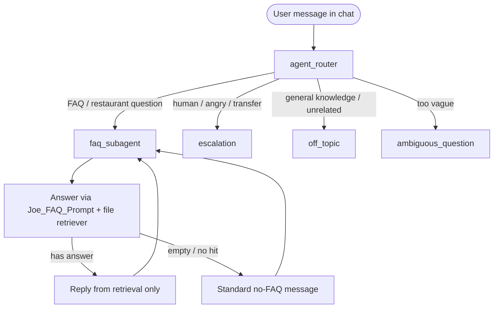

# Ambika FAQ subagent — minimal flow (Phase 1)

**Purpose:** Smallest FAQ path for `Ambika_Monday_Demo_Agent` while the team router design is still undefined.  
**Data:** Reuse **existing org FAQ** (Data 360 file library + prompt already wired for TableCraft demo). **Do not** create a second Ambika-only lake/DMO or delete `Restaurant__c`, `ambika_restaurant_faq.csv`, or other team assets.

**Out of scope for this slice:** name/zip restaurant lookup, bookings CRUD, full orchestrator handoff back to router (stub router collects inputs until orchestrator exists).

---

## Input contract (required before FAQ)

FAQ is not a separate API with a JSON body. **Required inputs = agent variables** that must be set before `faq_subagent` runs.

| Variable | Required | Set by | Used for |
|----------|----------|--------|----------|
| **`restaurant_id`** | Yes | Router / future orchestrator (`set_faq_context`) | Scope, copy, future retriever filter |
| **`escalation_phone_number`** | Yes | Same | Handoff / “call us” copy; escalation context |
| **User question** | Yes (each turn) | Transcript (latest user message) | Mapped at action call to `Answer_TableCraft_FAQ` → `Input:question` |

Orchestrator **`user_intent`** (routing only) is not on this agent yet—add when the team router lands.

**Enforcement in `Ambika_Monday_Demo_Agent.agent`:**

1. **`go_to_faq_subagent`** — `available when` `restaurant_id` and `escalation_phone_number` are non-empty.  
2. **`faq_subagent.before_reasoning`** — if either input is empty → `transition to @subagent.agent_router`.  
3. **`set_faq_context`** on router — `@utils.setVariables` for both fields (until orchestrator sets them upstream).

Defaults are **empty** (strict). For messaging preview, set variables in the test harness or complete one turn that calls `set_faq_context` (e.g. restaurant `REST-ATX-01` + phone from CRM/FAQ).

Guardrails and “no FAQ hit” copy live in **`Ambika_TableCraft_FAQ_Prompt`** — see [ambika-faq-prompt-guardrails.md](./ambika-faq-prompt-guardrails.md). Retriever **`searchText`** is still **`Input.question`** only until per-`restaurant_id` filter exists.

**Agent variables (intentionally minimal):** only `restaurant_id` and `escalation_phone_number`. No Messaging-session **linked** variables (`ContactId`, `EndUserId`, etc.)—those are channel plumbing, not FAQ inputs. Re-add linked vars if Messaging preview or `@utils.escalate` fails after deploy.

---

## What the subagent must handle

Only **restaurant FAQ-style questions** once **`restaurant_id`** is set (Phase 1 retrieval still uses the **shared** FAQ PDF library in the org).

| Step | Behavior |
|------|----------|
| 1. **User asks a FAQ question** | Hours, parking, menu/policy, dress code, dietary *as covered in FAQ*, phone/location *as in FAQ*, general “how do you…?” about the restaurant. |
| 2. **Retrieve** | Call the FAQ action (prompt + Einstein retriever on the existing file library). **No** answers from model memory. |
| 3. **Answer** | If the action returns text, reply briefly in a warm tone. Optional citations if enabled on the agent. |
| 4. **Refuse** | If nothing relevant is retrieved, say you do not have that in the FAQ and offer to connect to a person (do not invent menu items or policies). |
| 5. **Stay in FAQ** | User can ask another FAQ question in the same thread; subagent keeps using retrieval only. |
| 6. **Not FAQ** | Router sends escalation / off-topic / ambiguous elsewhere—not handled inside `faq_subagent`. |

---

## Flow (this agent only)

---

## Router rule (minimal, until orchestrator exists)

- **→ `faq_subagent`:** User is asking for **information** about the restaurant (policies, hours, menu, parking, amenities, “do you have…?”).
- **→ `escalation`:** User asks for a **person**, or issue needs human (complaint, allergy confirmation beyond FAQ text, etc.).
- **→ `off_topic` / `ambiguous_question`:** Template guardrails (unchanged).

Router must **`set_faq_context`** (or orchestrator equivalent) before FAQ routing; subagent bounces to router if inputs are missing.

---

## Data & actions (no new Ambika corpus)

| Asset | Role |
|-------|------|
| `ADL_Diner_Restauran` (org) | Existing PDF FAQ library |
| `Joe_FAQ_Prompt` (org) | Prompt + `File_Diner_Restaurant_FAQ_and_Policies` retriever |
| `data/ambika_restaurant_faq.csv` (git) | Stays as-is; optional future ingest—**not** a blocker for this subagent |
| `knowledge.rag_feature_config_id` | Same RAG feature ID as demo FAQ agent (`data/data360_assets.json`) |

---

## Smoke-test utterances (manual)

1. “What are your hours on Sunday?” → answer from FAQ if present.  
2. “Do you have gluten-free options?” → FAQ or safe handoff per prompt rules.  
3. “What’s the weather in Austin?” → router → off_topic.  
4. “I need a human.” → router → escalation.  
5. “Tell me about your truffle pasta” → FAQ if in doc, else refuse without inventing.

---

## Related

- [ambika-monday-demo-faq-pipeline.md](./ambika-monday-demo-faq-pipeline.md) — numbered pipeline, design decisions, and where each piece lives in git/org  
- [ambika_schema.md](./ambika_schema.md) — CRM vs Data 360 split  
- [data/data360_assets.json](../data/data360_assets.json) — RAG IDs
