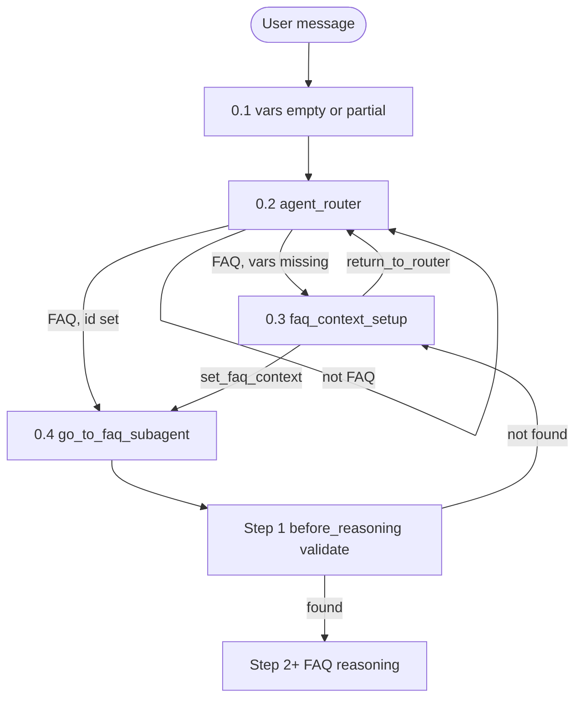
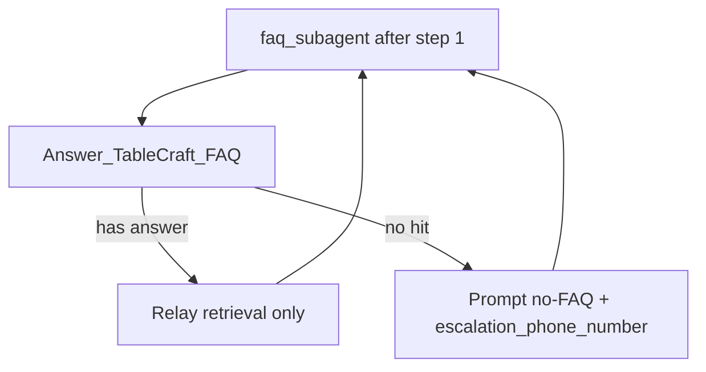

# Ambika_Monday_Demo_Agent — FAQ subagent pipeline (design checklist)

**Why this agent exists:** Thin **Preview harness** around the FAQ subagent path. **Step 0** (0.1–0.4) is mostly **demo scaffolding**—stub router and `faq_context_setup` until a team orchestrator sets `restaurant_id`. **Steps 1–10** are the **FAQ bundle meant to ship**: entry CRM gate, grounded FAQ action, prompt, and retriever wiring (lift into the production agent; replace step 0.3 with orchestrator handoff).

## End-to-end chain (input → output)

**Demo harness (step 0 — largely replaced in production)**

```text
User message
  → [0.1] Variable defaults (empty context)
  → [0.2] agent_router (route — no FAQ action)
  → [0.3] faq_context_setup + set_faq_context (placeholder for orchestrator restaurant handoff)
  → [0.4] Transition to faq_subagent (restaurant_id set)
```

**FAQ subagent bundle (steps 1–10 — intended to carry forward)**

```text
  → [1] faq_subagent before_reasoning (Agent Script hook, not LLM) — CRM validate + hydrate escalation_phone_number
  → [2] faq_subagent reasoning (planner → Answer_TableCraft_FAQ)
  → [3] Einstein Trust Layer (planner / action path)
  → [4] Agent Script action → Prompt Builder invocation
  → [5] Einstein Trust Layer (prompt / LLM request)
  → [6] RAG (Einstein retriever → Data 360 FAQ library)
  → [7] Prompt template (guardrails + LLM answer)
  → [8] Einstein Trust Layer (LLM response)
  → [9] faq_subagent relay → user message
  → [10] Stay in faq_subagent OR return to agent_router
```

---


## Step 0 — Demo harness (router, context setup, handoff)

**Step 0** substeps **0.1–0.4** only—get `restaurant_id` into session and transition into `faq_subagent`. **Not** the long-term product path: **0.3** stands in for a future orchestrator. **Steps 1–10** (below) are what you reuse when merging this work into the team agent. This bundle has **three** topics—no separate escalation, off-topic, or bookings subagents.

### Step 0 substeps (summary)


| Substep | Where                             | What happens                                                                                                                                                                                                                                                 |
| ------- | --------------------------------- | ------------------------------------------------------------------------------------------------------------------------------------------------------------------------------------------------------------------------------------------------------------ |
| **0.1** | Agent Script `variables:`         | Session starts with `restaurant_id` empty, `restaurant_validated` false, `escalation_phone_number` empty (filled from CRM in **step 1**). FAQ question is **not** a variable—it only exists in the transcript.                                                  |
| **0.2** | `agent_router`                    | Hyperclassifier reads the user message and **chooses a transition only** (no variable writes, no FAQ action): `go_to_faq_context_setup`, `go_to_faq_subagent` (if `restaurant_id` set), or stay and steer (non-FAQ / unclear).                               |
| **0.3** | `faq_context_setup`               | **Always required in this demo agent** (placeholder until a real orchestrator sets `restaurant_id`). Planner collects `restaurant_id` **only** (Preview paste simulates handoff), calls `set_faq_context`. **No CRM, no phone** — not a validation subagent. |
| **0.4** | Router or setup → `faq_subagent`  | `go_to_faq_subagent` only when `restaurant_id` is non-empty. Transition only; **step 1** runs on entry; FAQ retrieval waits until pipeline step **4**.                                                                                                      |




*(Mermaid continues into **steps 1–10** after handoff **0.4**.)*

### Step 0.1 — Initial variable state

- **What runs:** Nothing executes—defaults are declared once per session.
- **State:** `restaurant_id = ""`, `escalation_phone_number = ""`, `restaurant_validated = false`.
- **Design:** Context is **agent variables**, not Messaging linked fields (`ContactId`, etc.).
- **Code:** [Ambika_Monday_Demo_Agent.agent](../force-app/main/default/aiAuthoringBundles/Ambika_Monday_Demo_Agent/Ambika_Monday_Demo_Agent.agent) — `variables:`.


### Step 0.2 — `agent_router`

- **What runs:** `DefaultEinsteinHyperClassifier` picks `go_to_faq_context_setup` or `go_to_faq_subagent` (or neither—conversational steer in-router). **Router model:** keep `DefaultEinsteinHyperClassifier` on `agent_router` — transition routing only. If Builder switches to **Default LLM**, Preview often fails with *“Sorry, it looks like something has gone wrong.”* ([publish-ambika-monday-demo-agent.md](./setup/publish-ambika-monday-demo-agent.md)).
- **Gates:** `go_to_faq_subagent` only if `restaurant_id` is non-empty. `restaurant_validated` is set in **step 1** on FAQ entry, not on the router.
- **Router rules (minimal):** → `faq_context_setup` when FAQ intent but `restaurant_id` missing; → `faq_subagent` when `restaurant_id` set and user asks restaurant **information** (hours, menu, policies, parking, amenities). No `escalation`, `off_topic`, or `ambiguous_question` subagents in this bundle — human handoff copy uses CRM `escalation_phone_number` in the FAQ prompt when retrieval has no answer.
- **Does not:** Call `set_faq_context`, call FAQ action, or hit CRM.
- **Code:** `start_agent agent_router`, actions `go_to_faq_context_setup`, `go_to_faq_subagent`.


### Step 0.3 — `faq_context_setup` + `set_faq_context`

- **What runs:** Subagent planner collects `restaurant_id` from chat (or pasted test value), then `set_faq_context` writes `restaurant_id` only.
- **Future orchestrator:** Another agent/subagent would set `restaurant_id` after name/zip lookup; **this demo subagent simulates that handoff** when you paste `REST-ATX-01`. Phone is **never** collected here.
- **Then:** **0.4** `go_to_faq_subagent`; CRM validation is **not** in this topic.
- **Code:** `subagent faq_context_setup` → `set_faq_context`, `go_to_faq_subagent`, `return_to_router`.


### Step 0.4 — Handoff to `faq_subagent`

- **What runs:** `go_to_faq_subagent` from **0.2** (id already in session) or **0.3** after `set_faq_context`.
- **Gate:** `restaurant_id` non-empty only. Does **not** run FAQ retrieval yet. **Step 1** runs immediately on entry (same activation, before the FAQ planner).
- **Code:** `go_to_faq_subagent` on router and setup.

**End of step 0 harness.** Next: [Step 1](#step-1--pre-faq-crm-gate-faq_subagentbefore_reasoning) and **steps 2–10** (FAQ bundle to ship).

### Agent variables (0.3 sets; step 1 validates — see [FAQ bundle](#step-1--pre-faq-crm-gate-faq_subagentbefore_reasoning))


| Input                     | Set in                                                  | Validated in pipeline                     | Used from step                          |
| ------------------------- | ------------------------------------------------------- | ----------------------------------------- | --------------------------------------- |
| `restaurant_id`           | **0.3** `set_faq_context` (user / orchestrator)         | **Step 1** CRM row must exist             | **4+** prompt / future RAG filter       |
| `escalation_phone_number` | **Step 1** only (`@outputs.phone` → CRM `Phone_Number__c`) | Not user input                        | **7** no-FAQ copy                       |
| `restaurant_validated`    | **Step 1** from `found`                                 | Must be **true** after **step 1** for FAQ | Routing / re-entry to setup if false    |
| **User question**         | Transcript                                              | —                                         | **4** `Input:question`, **6** retriever |


**Typical Preview sequence:**

1. **0.2** — “Hi” → steer; no FAQ.
2. **0.3** — *“Restaurant ID is REST-ATX-01”* → `set_faq_context`.
3. **0.4 → step 1** — enter `faq_subagent` → CRM validate on entry → `restaurant_validated`, `escalation_phone_number` from `Phone_Number__c`.
4. **2+** — *“What are your hours?”* → FAQ action chain.

**Agentforce design (step 0 only):** Variable writes in **0.3**; handoff **0.4**. Orchestrator replaces **0.2–0.3** in production; **0.4**-style transition still needed from upstream.

**Harness enforcement in** `Ambika_Monday_Demo_Agent.agent` **(step 0):**

1. `go_to_faq_context_setup` (router) — FAQ needed but `restaurant_id` missing.
2. `set_faq_context` — `restaurant_id` only; clears `restaurant_validated` and `escalation_phone_number` when id changes.
3. `go_to_faq_subagent` (router + setup) — when `restaurant_id` set (CRM runs at **step 1** on FAQ entry).

**Preview (harness):** paste `REST-ATX-01` (simulates orchestrator **0.3**), then ask an FAQ question (**steps 1–10**).

**See also:** [publish-ambika-monday-demo-agent.md](./setup/publish-ambika-monday-demo-agent.md) (router model), [ambika_schema.md](./ambika_schema.md) (CRM vs Data 360).

---


## FAQ subagent bundle (steps 1–10)

Steps **1–10** are the **product path under test**—copy or merge into the team agent (`faq_subagent` topic, prompt action, Apex validate, shared FAQ library). They do **not** depend on **0.3** except needing `restaurant_id` already set upstream.

## Step 1 — Pre-FAQ CRM gate (`faq_subagent.before_reasoning`)

- **Ships with FAQ bundle:** Yes — keep this hook and `validate_restaurant_context` when moving off the demo harness.
- **What runs:** On `faq_subagent` activation, **before** FAQ planner/reasoning (step **2**): deterministic `run validate_restaurant_context` → `CLL_DinerService.validateRestaurantByCode`. Empty `restaurant_id` → **0.3**; on CRM miss → **0.3**. On success: `restaurant_validated = true` and `escalation_phone_number` = CRM `Phone_Number__c`.
- **Why phone lands here:** The **restaurant-id check before FAQ** is the natural place to load **all CRM-backed context for that ID** in one shot. `escalation_phone_number` is an **agent input variable** for pipeline steps **4+** (prompt / no-FAQ copy)—not user input, not something the FAQ planner should fetch again.
- **Name note:** `before_reasoning` is the **known Agent Script term** for this hook (fixed platform keyword — deterministic script, **not** an LLM/planner step). In `.agent` source it must stay `before_reasoning`.
- **Agentforce design decision:** **Hard prerequisites** and **CRM hydration** belong in Agent Script, not in Prompt Builder or `faq_context_setup`—fail closed before any retrieval or LLM call. Does **not** replace name/city/zip discovery (`CLL_FindRestaurant` on other agents). Does **not** prove FAQ content exists for that restaurant (retriever filter is still step **6** future work).
- **Design note:** **Step 1** is **not** owned by `faq_context_setup` (**0.3**). **`set_faq_context`** clears `restaurant_validated` and `escalation_phone_number` so the next FAQ entry re-runs **step 1**.
- **Executed in:** Agent Script (`before_reasoning`) → Apex → `CLL_DinerService` (`WITH USER_MODE` SOQL on `Restaurant__c`).
- **Code location:**
  1. [CLL_DinerService.cls](../force-app/main/default/classes/CLL_DinerService.cls) — Invocable `validateRestaurantByCode`
  2. [Ambika_Monday_Demo_Agent.agent](../force-app/main/default/aiAuthoringBundles/Ambika_Monday_Demo_Agent/Ambika_Monday_Demo_Agent.agent) — `validate_restaurant_context`; `run` in `before_reasoning`

**FAQ bundle enforcement (step 1):** `faq_subagent.before_reasoning` — `run validate_restaurant_context`; on failure or empty id → `faq_context_setup` (in production, route to orchestrator or error topic instead). Prompt guardrails: [ambika-faq-prompt-guardrails.md](./learning/ambika-faq-prompt-guardrails.md).

---


## FAQ subagent behavior (Phase 1)

Once `restaurant_id` passes **step 1**, the subagent handles **restaurant FAQ-style questions** only (shared org FAQ library; no model memory).


| Step                            | Behavior                                                                                                                               |
| ------------------------------- | -------------------------------------------------------------------------------------------------------------------------------------- |
| 1. **User asks a FAQ question** | Hours, parking, menu/policy, dress code, dietary *as in FAQ*, phone/location *as in FAQ*, general “how do you…?” about the restaurant. |
| 2. **Retrieve**                 | `Answer_TableCraft_FAQ` (prompt + Einstein retriever). **No** answers from planner memory.                                             |
| 3. **Answer**                   | Relay action text; warm tone; optional citations if enabled.                                                                           |
| 4. **Refuse**                   | No relevant retrieval → prompt “no FAQ” copy + handoff phone from variables; do not invent policies or menu items.                     |
| 5. **Stay in FAQ**              | Follow-up FAQ questions stay in `faq_subagent` (retrieval only).                                                                       |
| 6. **Not FAQ**                  | FAQ-only bundle: router steers toward restaurant FAQ or missing `restaurant_id`.                                                       |





---


## Step 2 — `faq_subagent` reasoning instructions

- **What runs:** Subagent **planner** LLM decides to invoke `Answer_TableCraft_FAQ` and bind inputs from variables + transcript.
- **Agentforce design decision:** **Thin orchestration**—one action, relay output; **do not** duplicate FAQ content policy here (that lives in Prompt Builder).
- **Guardrails around:** Tool use only; no general-knowledge answers; do not repeat prompt rules to the user.
- **Executed in:** Agent Script (subagent planner LLM).
- **Code location:** [Ambika_Monday_Demo_Agent.agent](../force-app/main/default/aiAuthoringBundles/Ambika_Monday_Demo_Agent/Ambika_Monday_Demo_Agent.agent) — `subagent faq_subagent` → `reasoning.instructions` and action bindings (`with "Input:question"`, `with "Input:restaurant_id"`, etc.).

---


## Step 2b — Agent-wide system instructions (light touch)

- **What runs:** May influence tone across subagents when the platform merges system context.
- **Agentforce design decision:** High-level **agent persona** for the whole bundle—not the detailed FAQ policy layer.
- **Guardrails around:** “Use approved FAQ retrieval only”; no restaurant answers from general knowledge (summary level).
- **Executed in:** Agent Script.
- **Code location:** [Ambika_Monday_Demo_Agent.agent](../force-app/main/default/aiAuthoringBundles/Ambika_Monday_Demo_Agent/Ambika_Monday_Demo_Agent.agent) — `system.instructions`.

---


## Step 3 — Einstein Trust Layer (planner / invocable path)

- **What runs:** Platform policy on generative or invocable AI calls when the subagent planner and/or action is invoked.
- **Agentforce design decision:** **Einstein Trust Layer** is org-level—not where you author TableCraft FAQ wording or retrieval rules.
- **Guardrails around:** Platform safety, toxicity, data masking, audit/logging (as configured in the org).
- **Executed in:** Einstein Trust Layer (Setup / org policy).
- **Code location:** Not in git — configure in the **Salesforce org** (Trust Layer / Einstein generative AI settings).

---


## Step 4 — `Answer_TableCraft_FAQ` action

- **What runs:** Agent Script action calls `generatePromptResponse://Ambika_TableCraft_FAQ_Prompt` with prompt inputs.
- **Agentforce design decision:** **One local action = one Prompt Builder template** for grounded FAQ generation.
- **Guardrails around:** Wire `Input.question`, `Input.restaurant_id`, `Input.escalation_phone_number` from agent state into the prompt.
- **Executed in:** Agent Script action → Prompt Builder invocation.
- **Code location:**
  - Action definition: [Ambika_Monday_Demo_Agent.agent](../force-app/main/default/aiAuthoringBundles/Ambika_Monday_Demo_Agent/Ambika_Monday_Demo_Agent.agent) — `subagent faq_subagent` → `actions.Answer_TableCraft_FAQ`
  - Target template: [Ambika_TableCraft_FAQ_Prompt.genAiPromptTemplate-meta.xml](../force-app/main/default/genAiPromptTemplates/Ambika_TableCraft_FAQ_Prompt.genAiPromptTemplate-meta.xml)

---


## Step 5 — Einstein Trust Layer (prompt / LLM request)

- **What runs:** Trust policies applied when the prompt template executes its generative step.
- **Agentforce design decision:** Same Trust Layer as step 3; applies to **Prompt Builder** LLM calls.
- **Guardrails around:** Pre-generation checks on prompt payload and inputs (org-configured).
- **Executed in:** Einstein Trust Layer.
- **Code location:** Not in git — org configuration.

---


## Step 6 — RAG retrieval

- **What runs:** Einstein Search data provider runs retriever with `searchText` = `Input.question`; hits Data 360–backed FAQ file library chunks.
- **Agentforce design decision:** **Retrieval is configured on the prompt template**, not via agent `knowledge.rag_feature_config_id` for this FAQ action path.
- **Guardrails around:** Retrieve from the **shared FAQ file library** only; `searchText` is the user question (**no** `restaurant_id` **filter on retriever yet**).
- **Executed in:** Einstein retriever + Data 360 (file ingest / search index in org).
- **Code location:**
  - Retriever binding (git): [Ambika_TableCraft_FAQ_Prompt.genAiPromptTemplate-meta.xml](../force-app/main/default/genAiPromptTemplates/Ambika_TableCraft_FAQ_Prompt.genAiPromptTemplate-meta.xml) — `templateDataProviders` (`File_Diner_Restaurant_FAQ_and_Policies_1Cx_8Ec8b60f20d`)
  - Org asset inventory (reference): [data360_assets.json](../data/data360_assets.json) — `ADL_Diner_Restauran`, RAG feature IDs
  - Live corpus: **org only** (Data Cloud UI / `ADL_Diner_Restauran__dlm` SOQL), not deployable as DLO metadata in this repo today

**See also:** [What is an Einstein retriever?](./learning/ambika-einstein-retriever.md)

---


## Step 7 — Prompt template body + LLM

- **What runs:** Jinja prompt assembles passages + GUARDRAILS + diner question; `DefaultGPT5Mini` produces the FAQ reply.
- **Agentforce design decision:** **Content guardrails and refusal copy belong in Prompt Builder** for every grounded FAQ answer.
- **Guardrails around:** Passages-only facts; exact “no FAQ” strings with escalation phone; allergen/medical handoff; defer bookings; brevity; no meta (“sources”, “rules”).
- **Executed in:** Prompt Builder (`GenAiPromptTemplate`).
- **Code location:** [Ambika_TableCraft_FAQ_Prompt.genAiPromptTemplate-meta.xml](../force-app/main/default/genAiPromptTemplates/Ambika_TableCraft_FAQ_Prompt.genAiPromptTemplate-meta.xml) — `templateVersions.content`, `primaryModel`  
  - Rule checklist mirror: [ambika-faq-prompt-guardrails.md](./learning/ambika-faq-prompt-guardrails.md)

**See also:** [What is a Jinja prompt?](./learning/ambika-jinja-prompt.md)

---


## Step 8 — Einstein Trust Layer (model output)

- **What runs:** Post-generation filtering / logging on LLM output before it returns to the action.
- **Agentforce design decision:** Platform output governance—not custom TableCraft logic.
- **Guardrails around:** Output safety and compliance policies (org-configured).
- **Executed in:** Einstein Trust Layer.
- **Code location:** Not in git — org configuration.

---


## Step 9 — Output to user

- **What runs:** `promptResponse` returns to the FAQ subagent; planner sends text to the user in Messaging / preview.
- **Agentforce design decision:** Subagent **relays** prompt output; avoids a second “creative” pass that could hallucinate.
- **Guardrails around:** “Relay only” (reinforced in step 2 reasoning instructions).
- **Executed in:** Agent Script subagent planner + action outputs.
- **Code location:** [Ambika_Monday_Demo_Agent.agent](../force-app/main/default/aiAuthoringBundles/Ambika_Monday_Demo_Agent/Ambika_Monday_Demo_Agent.agent) — `faq_subagent` reasoning; `Answer_TableCraft_FAQ` → `outputs.promptResponse`.

---


## Step 10 — Stay in FAQ or return to `agent_router`

- **What runs:** Next user message is handled in `faq_subagent` again (typical FAQ follow-up), **or** script transitions to router.
- **Agentforce design decision:** FAQ is **sticky** in the subagent until context changes or an explicit transition fires—not every turn re-enters the router.
- **Guardrails around:** `return_to_router` when restaurant/phone context changes; `before_reasoning` bounce to `faq_context_setup` if inputs cleared; router handles new intents on transition.
- **Executed in:** Agent Script.
- **Code location:** [Ambika_Monday_Demo_Agent.agent](../force-app/main/default/aiAuthoringBundles/Ambika_Monday_Demo_Agent/Ambika_Monday_Demo_Agent.agent) — `return_to_router`; step 1 `before_reasoning`; steps **0.2–0.3** for re-entry and context collection.

---


## Manual smoke tests

After `REST-ATX-01` + successful **step 1**:

1. “What are your hours on Sunday?” → FAQ answer if in library.
2. “Do you have gluten-free options?” → FAQ or handoff per prompt rules.
3. “What’s the weather in Austin?” → router steers to restaurant FAQ (no off-topic subagent).
4. “I need a human.” → FAQ prompt handoff when applicable, or router asks for context.
5. “Tell me about your truffle pasta” → FAQ if in doc, else refuse without inventing.

---


## Not on this FAQ path (Ambika bundle)

- `**knowledge.rag_feature_config_id**` on the agent — defined in [Ambika_Monday_Demo_Agent.agent](../force-app/main/default/aiAuthoringBundles/Ambika_Monday_Demo_Agent/Ambika_Monday_Demo_Agent.agent) (`knowledge:`). **Not used** by `Answer_TableCraft_FAQ`; retriever is on the prompt. ID documented in [data360_assets.json](../data/data360_assets.json) for alignment / future use.
- `**Joe_FAQ_Prompt**` — org template used by Joe’s agent only. Ambika uses [Ambika_TableCraft_FAQ_Prompt.genAiPromptTemplate-meta.xml](../force-app/main/default/genAiPromptTemplates/Ambika_TableCraft_FAQ_Prompt.genAiPromptTemplate-meta.xml).
- **Messaging linked variables** (`ContactId`, `EndUserId`, etc.) — removed from this bundle; not required for FAQ retrieval.

---


## File index (Ambika FAQ only)

**Demo harness (step 0 — replace in production):** `agent_router`, `faq_context_setup` in [Ambika_Monday_Demo_Agent.agent](../force-app/main/default/aiAuthoringBundles/Ambika_Monday_Demo_Agent/Ambika_Monday_Demo_Agent.agent).

**FAQ bundle to ship (steps 1–10):**

- `faq_subagent` (step 1 `before_reasoning` through step 10 transitions) + `Answer_TableCraft_FAQ` wiring — same `.agent` file
- Step **1** CRM validation — [CLL_DinerService.cls](../force-app/main/default/classes/CLL_DinerService.cls) (`validateRestaurantByCode`)
- Bundle metadata — [Ambika_Monday_Demo_Agent.bundle-meta.xml](../force-app/main/default/aiAuthoringBundles/Ambika_Monday_Demo_Agent/Ambika_Monday_Demo_Agent.bundle-meta.xml)
- FAQ guardrails + retriever + LLM — [Ambika_TableCraft_FAQ_Prompt.genAiPromptTemplate-meta.xml](../force-app/main/default/genAiPromptTemplates/Ambika_TableCraft_FAQ_Prompt.genAiPromptTemplate-meta.xml)
- Prompt guardrail checklist — [ambika-faq-prompt-guardrails.md](./learning/ambika-faq-prompt-guardrails.md)
- CRM vs Data 360 — [ambika_schema.md](./ambika_schema.md)
- Optional future FAQ CSV (git, not a blocker) — [ambika_restaurant_faq.csv](../data/ambika_restaurant_faq.csv)
- Data 360 / RAG IDs (reference) — [data360_assets.json](../data/data360_assets.json) (`ADL_Diner_Restauran`, RAG feature IDs)

---


## Related

- [learning/](./learning/README.md) — concept docs (Einstein retriever, Jinja prompt, FAQ guardrails)
- [ambika_schema.md](./ambika_schema.md)
- [publish-ambika-monday-demo-agent.md](./setup/publish-ambika-monday-demo-agent.md)
- [org-data-inventory.md](./org-data-inventory.md)

