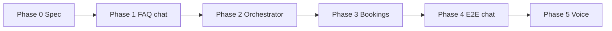
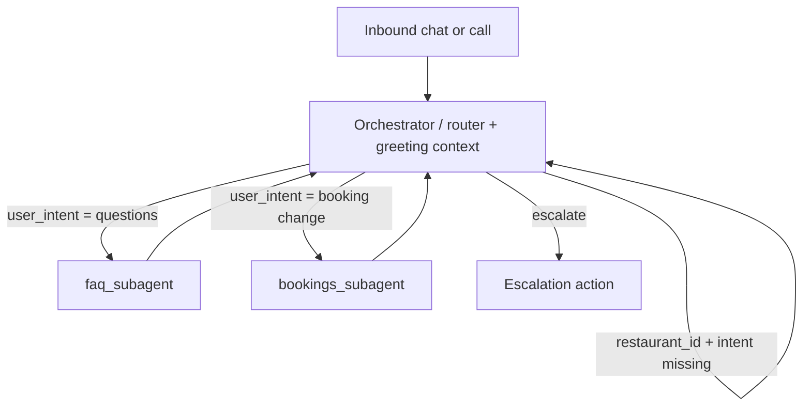
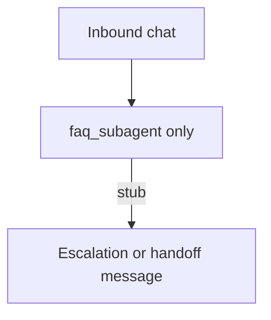

# Restaurant agent — specification (draft)

**Status:** Brainstorm / design — do not treat as implemented.  
**Project type:** Demo / prototype. Team creates **all** data (CRM, Data 360, FAQs, menus) — use that to keep lookups and answers **deterministic** and delivery fast.  
**Repo:** `my-agentforce-project` (Agent Script in `aiAuthoringBundles/`).

**North-star channel:** Voice — one inbound number for all restaurants (“headless”; no per-restaurant IVR tree).  
**Current channel:** **Chat / messaging first** (existing `MessagingSession`-style context in the demo bundle). Voice is a later increment on the same subagents and data.

---

## Project scope & constraints

| Aspect | Full product vision | This demo / prototype |
|--------|---------------------|------------------------|
| Restaurants | Many; name + zip lookup | Start with **one** test restaurant (e.g. `R001`) |
| Orchestrator | Greeting + context + routing | **Deferred** until FAQ slice is proven |
| FAQ subagent | All restaurants via `restaurant_id` | **Isolated** test: stub or default `restaurant_id` + escalation number |
| Bookings subagent | CRUD allow-list | **Later** (Luke); not on critical path for FAQ day-1 |
| Data | CRM + Data 360 Menus + FAQs | **Own the corpus** — small, curated FAQ set (≈10–15 Q&As) + hours / menu blurb |
| Retrieval | RAG on FAQs (goal) | **Path A** (CRM/context load) if faster; **Path B** (Data 360 RAG) when ingest/index is ready — see phases below |

**FAQ prototype target:** ~**one day** for a working **chat** FAQ subagent demo, not the full multi-subagent or voice stack.

---

## Delivery phases

Work proceeds in layers. Each phase should be demoable on its own before the next.

### Phase 0 — Spec & data design (current)

- Align on merged orchestrator design, session variables, subagent boundaries.
- Define demo restaurant record(s) and FAQ content the team writes.
- No requirement to implement full graph yet.

### Phase 1 — FAQ subagent only (Ambika — **active**)

**Goal:** Chat prototype that answers questions for **one** restaurant using **our** data.

- Single subagent (or FAQ-only agent bundle); **no** router, **no** name/zip lookup, **no** bookings CRUD.
- Session inputs for test: fixed `restaurant_id`, `escalation_phone_number` (mutable defaults or set at start of conversation).
- Load context via **CRM action** and/or **Data 360 retriever** (see FAQ data strategy).
- Behaviors to prove: answer from data only, “don’t know” without hallucination, update `user_intent` on booking mention, escalate on request.
- **Out of scope for Phase 1:** multi-restaurant disambiguation, Menus RAG at scale, E2E voice, Luke’s bookings object.

### Phase 2 — Orchestrator (Joseph)

- Combined **router + greeting/context**: name + zip → `restaurant_id`, `escalation_phone_number`, `user_intent`.
- Guardrails before FAQ / bookings routing.
- Still **chat**; expand demo data to a small multi-restaurant set if needed.

### Phase 3 — Bookings subagent (Luke)

- Bookings object + allow-list edits; escalate for new bookings and unsupported changes.
- Returns to orchestrator after each task.

### Phase 4 — Integration & hardening

- Wire FAQ ↔ orchestrator ↔ bookings in one agent graph.
- Broader test suite, guardrails, UX for stuck context collection (max turns / hangup).

### Phase 5 — Voice (optional / later)

- Same subagents and session variables; add telephony, STT/TTS, voice-specific prompt brevity, PSTN escalation.
- See **Channel strategy** below — not a rewrite of FAQ or bookings logic if chat was built channel-agnostic.

---

## Channel strategy: chat first, voice later

| Layer | Chat (Phase 1–4) | Voice (Phase 5) | Reuse |
|-------|------------------|-----------------|--------|
| Subagent graph & business rules | Yes | Same | High |
| Session variables (`restaurant_id`, `user_intent`, escalation) | Yes | Same concepts | High |
| CRM + Data 360 / FAQ retrieval | Yes | Same backends | High |
| Entry & variables | Messaging / `MessagingSession` | Voice session context (may need different Agent Script bindings) | Medium — remap, don’t redesign logic |
| Escalation | Queue / message / show number | Transfer to PSTN | Medium — same action contract, different implementation |
| UX | Longer answers, lists OK | Short spoken answers; no scrolling menu | Low — prompt tuning |

**Design for voice later (without building voice now):**

- Keep **functional subagent names** and instructions channel-neutral (“answer from restaurant context,” not “in this chat widget”).
- Treat escalation as one action parameterized by `escalation_phone_number`.
- Avoid chat-only assumptions in FAQ copy where possible; add “be concise” rules when voice lands.

**Effort expectation:** If Phase 1–4 are solid, adding voice is **moderate** (platform telephony + context bindings + spoken UX), not a full agent rewrite — unless the org requires custom telephony outside Salesforce voice.

---

## Team ownership (people ≠ subagent names)

| Developer | Workstream |
|-----------|------------|
| Joseph | Agent router / orchestration |
| Ambika | FAQ / Q&A subagent (+ Data 360 FAQ data & retrieval) |
| Luke | Bookings subagent (edit/delete rules) |
| Christian | (TBD — add when scoped) |

Subagents must use **functional names** (e.g. `faq_subagent`), not developer names.

---

## Product goal (north star)

End users contact **one entry point** (eventually **one phone number**; **chat in early phases**) to:

1. Identify **which restaurant** they mean.
2. Ask **questions** (hours, menu, policies, etc.) for that restaurant.
3. **Modify or cancel** an existing booking under strict rules.
4. **Escalate** to a human (restaurant escalation phone) when needed.

New **bookings** and unsupported changes → human escalation (not self-serve in v1).

**Phase 1 demo narrative:** “Ask anything about our demo restaurant — answers come from **our** FAQ and restaurant data; booking changes and humans are stubbed or escalated.”

---

## Architecture evolution

### Original idea (4 steps)

1. **User calls**
2. **`agent_router`** — loaded with subagent metadata; custom instructions to route first to greetings
3. **`greetings_context_subagent`** — collect `restaurant_id`, `escalation_phone_number`, `user_intent`
4. **Back to `agent_router`** — guardrails on context; route to FAQ or bookings or escalate
5. **`faq_subagent`** or **`bookings_subagent`** — work; always return to router + Atlas reasoning

### Current design direction

**Combine `agent_router` + `greetings_context_subagent`** into a single entry subagent (or enriched router) that:

- Greets and explains capabilities (Q&A + booking **changes** for a specific restaurant).
- Collects restaurant context and intent **before** handing off to FAQ or bookings.
- Enforces mandatory session variables (see below).

**Rationale:** Same conversational phase (who are you calling about + what do you want). Fewer handoffs, simpler graph, same guardrails.

Subagents still **return to the orchestrator** after their task (Atlas / router pattern unchanged).

**Target graph (Phase 2+):**

**Phase 1 graph (FAQ prototype only):**

Orchestrator and bookings nodes are intentionally omitted until Phase 2–3.

---

## Session variables (conversation context)

| Variable | Set by | Required before FAQ/bookings | Notes |
|----------|--------|------------------------------|--------|
| `restaurant_id` | Orchestrator (lookup) | Yes | Primary key on Restaurants |
| `escalation_phone_number` | Orchestrator (from Restaurants) | Yes | Used for human escalation |
| `user_intent` | Orchestrator (+ updated by FAQ/bookings) | Yes before routing | e.g. `questions`, `booking_change`, `escalate`; null → orchestrator clarifies |

### Orchestrator — greeting & context (merged behavior)

**Inputs:** None (or minimal chat/voice session context).

**Phase:** Orchestrator behavior is **Phase 2** — not required for FAQ-only demo.

**Mandatory outputs before leaving orchestrator phase:**

- `restaurant_id`
- `escalation_phone_number`
- `user_intent`

**Ideal flow:**

1. Introduce: answer questions or help with **existing** bookings for **one** restaurant.
2. Ask: restaurant **name** + caller **zip code**.
3. Resolve `restaurant_id` via Apex (or CRM query action) against **Restaurants**.
4. **Assumption (v1):** At most one restaurant with that name per zip code.  
   **Later:** disambiguate by street address; optional Google Maps “closest” optimization.
5. Capture `user_intent` from the caller, or ask explicitly before routing: questions vs booking change vs speak to human.
6. Do **not** route to FAQ/bookings until `restaurant_id` and `escalation_phone_number` are set.
7. If caller will not provide enough info to resolve restaurant → persist politely; **max loops / hangup UX TBD** with UX team.

**Data:** Restaurants object only in this phase.

---

## Orchestrator — routing guardrails

- Do **not** invoke FAQ or bookings if `restaurant_id`, `escalation_phone_number`, or `user_intent` are missing (except orchestrator continues collecting).
- If `user_intent` is still unclear after context collection, orchestrator asks: questions vs booking-related vs human.
- Route:
  - Questions → `faq_subagent`
  - Booking modifications/cancels → `bookings_subagent`
  - Human → escalation action (`escalation_phone_number`)

---

## Subagent: `faq_subagent` (Ambika — Phase 1)

**Purpose:** Answer restaurant-specific questions; exit when done or when caller wants booking changes.

**Phase 1 demo shortcuts (use controlled data):**

- One restaurant, e.g. **`R001` — “Bella’s Trattoria”** (name TBD): fixed `restaurant_id`, hours, phone, escalation number, short menu blurb.
- **10–15 FAQ pairs** the team writes so demo questions always hit known answers.
- No zip/name lookup in Phase 1 — orchestrator supplies `restaurant_id` later; until then, **default or hardcode** for chat tests.

### Inputs

| Variable | Source |
|----------|--------|
| `restaurant_id` | Session (orchestrator) |

### Outputs

| Variable | When |
|----------|------|
| `user_intent` | Update if caller mentions booking → before return to orchestrator |

### Behavior

1. **Load context** for `restaurant_id` (see Data strategy below).
2. Answer from that context only; no general knowledge.
3. Exit when caller is done with questions **or** mentions booking → set `user_intent` accordingly.
4. If answers seem unsatisfactory → offer human; escalate on yes.
5. Escalate immediately if caller asks for a human.
6. **Return to orchestrator** when integrated (Phase 2+). Phase 1 FAQ-only agent may end turn or stub handoff without a router.

### Actions

- `escalate_to_human` — use `escalation_phone_number` from session.

### Data strategy (FAQ workstream)

**Original sketch:** No RAG — load full **menu + hours + phone** into context as variables from Restaurants / related data.

**Demo-friendly direction:** Small curated datasets we control; optimize for **speed to working chat demo**, then deepen retrieval.

| Source | Content | Phase 1 use |
|--------|---------|-------------|
| **CRM — Restaurants** | Hours, phone, address, `restaurant_id`, menu blurb (text) | Primary structured context for one row |
| **CRM — FAQ** (optional child object or related records) | Q&A rows keyed by `restaurant_id` | **Path A:** single action returns JSON/text block for agent |
| **Data 360 — FAQs** | Same Q&A as CSV (`restaurant_id`, `question`, `answer`) | **Path B:** ingest, index, Agent Script `knowledge` / retriever |
| **Data 360 — Menus** | Full menu product | **Defer** — use short menu text on Restaurant for Phase 1 |

**Retrieval paths (pick based on org readiness):**

| Path | What it is | When to use |
|------|------------|-------------|
| **A — CRM context load** | Invocable / Flow / Apex loads restaurant + FAQs into prompt or variables | Fastest for ~1-day prototype; still “our data” |
| **B — Data 360 RAG** | FAQ corpus in Data Cloud + search index + agent knowledge config | When ingest/index already works or half-day budget reserved |

Paths are not mutually exclusive long-term: same FAQ rows can exist in CRM for dev and Data 360 for RAG demos.

**Phase 1 scope:** **`faq_subagent` in isolation** on **chat** — not full graph, not voice.

- Stub or default `restaurant_id`, `escalation_phone_number` in test harness.
- Prove answers, refusals, intent update, escalation in Agentforce messaging preview.
- Menus at scale / multi-restaurant → Phase 2+.

**FAQ subagent — suggested test checklist (draft)**

- [ ] Data 360 FAQ objects/files loaded for ≥1 test restaurant
- [ ] Search index / retriever configured and referenced from agent bundle
- [ ] Correct answers for sample FAQs (hours, policies, “do you have…”) for fixed `restaurant_id`
- [ ] Refusal / “I don’t know” when FAQ has no support (no hallucinated menu items)
- [ ] Intent handoff: mention “change my reservation” → `user_intent` updated
- [ ] Escalation path when user asks for human
- [ ] Return-to-orchestrator behavior in multi-subagent graph (integration later)

---

## Subagent: `bookings_subagent` (Luke — Phase 3)

**Purpose:** Limited self-serve changes to **existing** bookings; everything else escalates.

**Not in scope for Phase 1 FAQ demo.**

### Inputs

| Variable | Source |
|----------|--------|
| `restaurant_id` | Session |

### Allowed modifications

| Change | Allowed |
|--------|---------|
| Decrease party size | Yes |
| Move time **earlier** by 30 minutes | Yes |
| Move time **later** by 30 minutes | Yes |
| Cancel booking | Yes |
| Any other modification | Escalate |
| **New** booking | Escalate |

### Data

- **Bookings** object, related to **Restaurants** via `restaurant_id` (relationship TBD in schema).

### Actions

- Edit booking
- Delete / cancel booking
- Escalate to human

**Always return to orchestrator** after task or escalation.

---

## CRM data model (draft)

### Restaurants

| Field | Notes |
|-------|--------|
| `restaurant_id` | Primary key |
| Name | |
| Street address | |
| Zip code | Used in v1 disambiguation |
| Hours | FAQ + orchestrator |
| Phone number | Public restaurant phone |
| Escalation phone | Human handoff for agent |
| Relationship | → Bookings (child) |

### Bookings

| Field | Notes |
|-------|--------|
| Booking PK | TBD |
| `restaurant_id` | FK to Restaurants |
| Party size, time, status, etc. | CRUD for allowed edits |

Exact API names and Apex/data provider actions **TBD** in implementation spec.

---

## Data 360 (Data Cloud)

| Dataset | Owner / phase | Notes |
|---------|----------------|--------|
| **FAQs** | Ambika — Phase 1 (Path B) | Small CSV aligned with demo restaurant `R001`; document DMO/DLO, index, retriever ID when created |
| **Menus** | Shared — Phase 2+ | Full menu RAG deferred; CRM menu blurb sufficient for FAQ Phase 1 |

Document connector, DMO/DLO names, and retriever IDs in this section as they are created.

### Phase 1 — defer / avoid (keep demo shippable)

- Multi-restaurant name + zip disambiguation
- Google Maps “closest restaurant”
- Full bookings CRUD and Bookings object (unless Luke parallelizes)
- E2E voice and PSTN transfer
- Large menu corpus in Data 360 before FAQ works in chat

---

## Escalation

- Subagents and orchestrator use **`escalation_phone_number`** from Restaurants for the resolved `restaurant_id`.
- **Phase 1 (chat):** `@utils.escalate` or a clear handoff message showing the demo escalation number.
- **Phase 5 (voice):** PSTN transfer / platform voice escalate — telephony integration **TBD**.

---

## Guardrails (placeholder)

- Session variables required before FAQ/bookings routing
- FAQ: answer only from retrieved / loaded restaurant context
- Bookings: allow-list of edit types only
- No new bookings via agent in v1
- PII / payment — TBD
- Max turns before hangup when `restaurant_id` cannot be resolved — **UX TBD**

---

## Testing suite

| Phase | Layer | Scope | Owner |
|-------|--------|--------|-------|
| **1** | FAQ subagent only | Chat preview; fixed `R001`; 5–8 scripted utterances; Path A and/or B | Ambika |
| **2** | Orchestrator + context | Restaurant lookup, intent, guardrails | Joseph |
| **3** | Bookings subagent | CRUD allow-list + escalate paths | Luke |
| **4** | E2E chat | Full graph in messaging | Team |
| **5** | E2E voice | Call flow, transfer, spoken UX | Team |

Agentforce evaluation / test cases to be added under `docs/` or a dedicated `tests/` folder when defined.

**Phase 1 FAQ — minimum demo script (examples):**

- Hours today / holiday hours
- Parking / dress code / gluten-free (from written FAQs)
- “Do you have [menu item]?” (from menu blurb)
- “Change my reservation” → intent update or escalate stub
- “Speak to a person” → escalation

---

## Later optimizations (post–Phase 1)

- Multiple same-name restaurants in one zip → address disambiguation
- Google Maps API for “closest” location
- Full menu in Data 360 vs menu blurb in CRM
- Voice channel (Phase 5) — see **Channel strategy**
- Revisit split vs merged orchestrator only if Phase 2 integration surfaces issues

---

## Related repo artifacts (today)

| Artifact | Path |
|----------|------|
| Agent Script (demo bundle) | `force-app/main/default/aiAuthoringBundles/Ambika_Monday_Demo_Agent/Ambika_Monday_Demo_Agent.agent` |
| Published agent metadata | `force-app/main/default/aiAgents/`, `aiAgentDefinitionVersions/` |

This spec does **not** require changes to those files until implementation starts.

---

## Change log

| Date | Change |
|------|--------|
| 2026-10-26 | Initial spec from team brainstorm; router + greetings merge; FAQ Phase 1 + Data 360 RAG called out |
| 2026-10-26 | Added delivery phases (0–5), chat-first / voice-later strategy, demo scope, ~1-day FAQ prototype, Path A/B retrieval, Phase 1 defer list |
